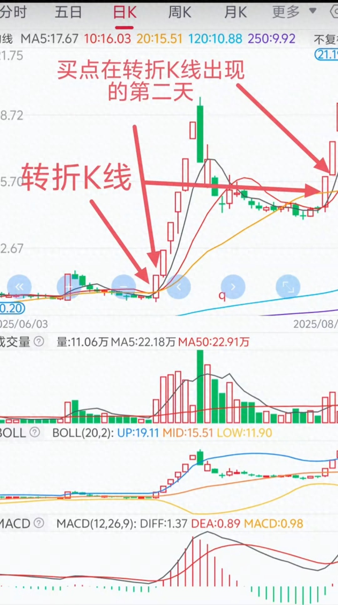

# 别再追涨杀跌！转折K线战法，让你精准抄底主升浪起点

> 作者：阳生说股 · 2026-05-05 · 今日头条
> 原文声明：内容仅供参考，不构成投资建议。

## 一、核心思想（一句话）

单根放量突破 K 线不足以确认反转；**等它第二天站稳突破位、量能延续再进场**，用“延迟一天”换取确定性，避开假突破诱多。

## 二、原文配图

原文正文共 5 个图片位，但它们全部指向同一张 1080×1932 的手机截图（同一图片资源，重复插入）。因此下面这张图就是全文唯一的图，图上的红色手写批注已经标出了两处案例的转折 K 线与买点。

图中红字批注原文：

- `转折K线` —— 指向低位横盘末端的那根小实体红 K（均线黏合处）
- `买点在转折K线出现的第二天` —— 指向紧随其后、放量上穿均线的红 K
- 横向长箭头把左侧第一处案例连到右侧第二次调整后的同类形态（二次进场）

截图下方面板依次为：成交量（含 MA5/MA50 量能线）、BOLL(20,2)、MACD(12,26,9)。均线组为 MA5/10/20/120/250。

## 三、原文全文

很多散户在A股里追涨杀跌，要么在高位接盘站岗，要么在底部割肉离场，核心问题就是没找对进场时机。

其实，趋势反转的信号早就藏在K线里，只要看懂“转折K线”的逻辑，就能在主升浪启动前精准上车。

就像这只个股的走势，前期股价在低位横盘震荡，均线黏合走平，市场情绪低迷，直到一根标志性的转折K线出现，彻底打破了僵局。

这根K线实体饱满，放量突破了短期均线压制，同时MACD金叉、布林带开口向上，明确发出了趋势反转的信号。但真正的进场点，并不是转折K线当天，而是它出现的第二天。

为什么要等第二天再进场？这正是转折K线战法的精髓所在。

当天的大涨可能是主力诱多的假突破，而第二天的走势，才是验证反转信号真伪的关键。如果第二天股价能够站稳突破位，成交量持续放大，说明资金认可度高，趋势反转的确定性大大提升；如果第二天股价冲高回落、跌破均线，就说明这只是一次短期反弹，进场反而容易被套。

这只个股的两次进场机会，都完美遵循了这个逻辑。

第一次转折K线出现后，第二天股价继续上涨，稳稳站上所有短期均线，此时进场，刚好买在了主升浪的起点，后续股价一路拉升，短短几天就收获了可观的涨幅。

第二次调整后的转折K线，同样是在第二天确认趋势后进场，避开了调整的波动，精准抓住了二次拉升的行情。

很多人总想着“买在最低点”，看到股价大涨就忍不住追进去，结果往往是“追涨在半山腰”。而转折K线战法，本质上是用“延迟进场”的方式，换取更高的确定性。多等一天，看似少赚了几个点，却能有效规避假突破的风险，大大提高交易的成功率。

除了K线本身，成交量和指标的配合也至关重要。转折K线必须伴随放量，说明有真实的资金进场；MACD要同步金叉，布林带要从收口转为开口，多维度验证趋势反转的信号。只有当这些条件同时满足，第二天的进场才是安全的。

说到底，交易不是比谁买得更低，而是比谁买得更对。与其在不确定的底部抄底，不如等趋势明确反转后再进场，用更高的确定性，换取更稳定的收益。

本文仅为技术分析方法分享，不构成任何投资建议，股市有风险，投资需谨慎。

## 四、可执行规则（按原文条件归纳）

原文只给定性描述，下面是把它翻译成可回测条件的版本，参数是我补的默认值，不是作者给的：

前提环境（T 日为转折 K 线当日）
- 前期低位横盘：过去 N=20 日振幅小，均线黏合（MA5/10/20 极差 / price < 3%）
- 市场情绪低迷：可选，量能低于 20 日均量

T 日：转折 K 线
- 实体饱满：`body / ATR20 > 0.8`，或实体占当根振幅 > 60%
- 收盘突破短期均线压制：`close > MA5, MA10, MA20`
- 放量：`vol > 1.5 × MA5(vol)`
- MACD 金叉：`DIFF` 上穿 `DEA`（当日或近 2 日内）
- BOLL 开口：带宽由收口转扩张（`width_t > width_{t-1}` 且前期 width 处于低位）

T+1 日：确认与进场
- 站稳突破位：`close_{T+1} > close_T`（或 > T 日突破的均线）
- 量能延续：`vol_{T+1} > vol_T × 0.8`（不强要求继续放大）
- 未破均线：`low_{T+1} > MA5`（原文“跌破均线”则放弃）
- 满足则次日开盘/T+1 收盘进场；失败则信号作废，不追

出场（原文未给，需自行定义）：建议以进场 K 线最低点或 MA10 为止损，跌破即出。

## 五、看法（存档备注，非原文）

- 属于典型“突破 + 一日确认”的过滤思路，本质上是在降低假突破率，牺牲一天涨幅。逻辑本身不新鲜，但过滤规则可量化，适合做为一个 regime / 入场确认模块。
- 原文最大的问题：只有一个案例（且同一张图重复 5 次），没有样本统计、没有胜率、没有失败案例展示，属于营销型技术分析文。图里“第二次进场”是同一只票的二次拉升，样本量=1，不能作为有效性证据。
- 与现有 `ts_7AZ_96MA_flow` 家族的关系：可作为 7AZ 突破信号的“T+1 确认”附加过滤，需回测验证是否提升 7 月回撤表现——注意确认日会推迟入场，可能错过一字板/跳空段。
- 无未来函数风险：所有条件在 T+1 收盘即可判定，进场最早 T+2 开盘（若按 T+1 收盘进场则必须确保用 T+1 收盘价成交）。这一点在实现时要严格对齐，否则就是 look-ahead。
